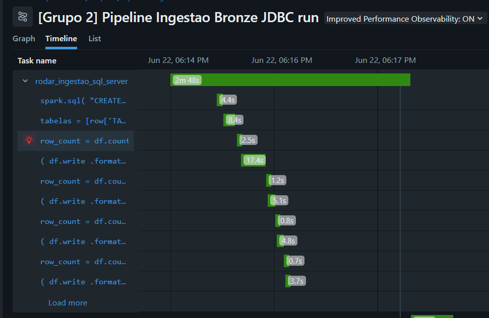

# Roadmap de Evolução e Pontos de Atenção 

## 1. Mapeamento dinâmico de metadados
📍 Código-alvo: src/bronze/ingestao_tabelas.py

Substituição da lista estática pela consulta dinâmica ao INFORMATION_SCHEMA.TABLES da origem.

### 🚀 Ganhos Imediatos
Automação Total: O pipeline se adapta sozinho à origem. Se novas tabelas forem criadas lá, a Bronze as ingere automaticamente na próxima execução.

Risco Zero de Erro Humano: Elimina falhas de digitação ou esquecimentos de manutenção manual no código.

Eficiência de TI: Centraliza a regra de captura, reduzindo o esforço de sustentação do time de dados.

### 1. Próximos Passos e Cenários de Risco

| Tópico | Cenário Atual / Risco | Ação Necessária / Mitigação |
| :--- | :--- | :--- |
| **Camada Silver** | Uma nova tabela será ingerida na Bronze, mas fica estagnada ali.  | Atualizar o pipeline da Silver para mapear as regras de negócio e limpeza para que os dados sigam viagem. |
| **Evolução de Schema** | Se uma coluna for deletada na origem, a Bronze atualiza, mas a Silver e os relatórios que dependem dela quebram. | Implementar testes de contrato de dados (*Data Contracts*) antes da fase de ingestão. |
| **Performance (Spark)** | Uso consecutivo de `df.count()` (logs) e `df.write` (gravação) gerou **17.4s** de lentidão devido ao *Lazy Evaluation* (leitura dupla no SQL Server). | Avaliar o uso de `.cache()` logo após a leitura da origem para manter os dados na memória do cluster.

## 2.[Próxima melhoria]
Sugestão de tópico: Ingerir na bronze uma tabela de taxa de cambio.